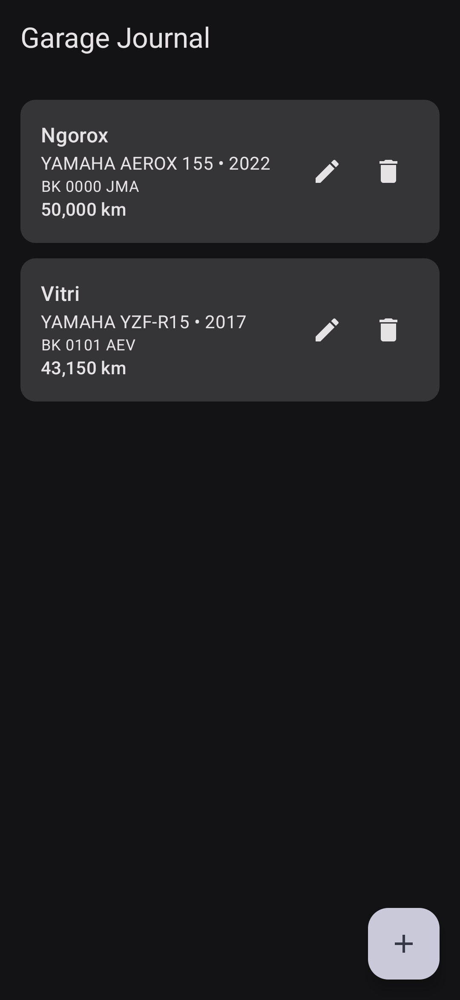
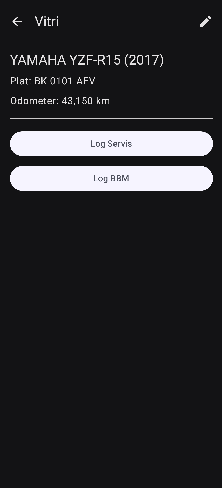
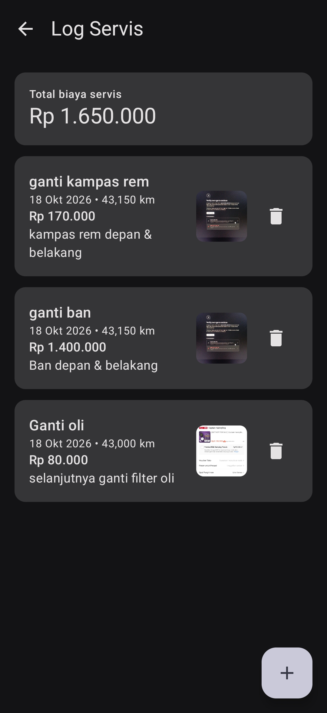
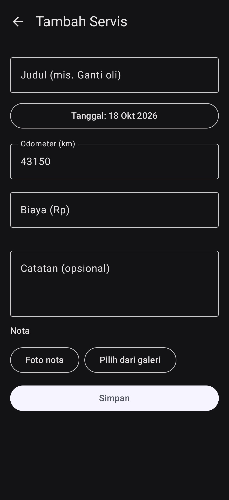
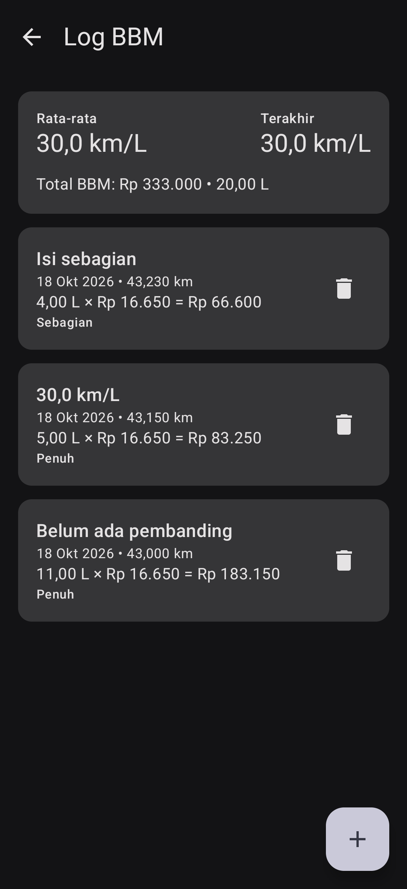
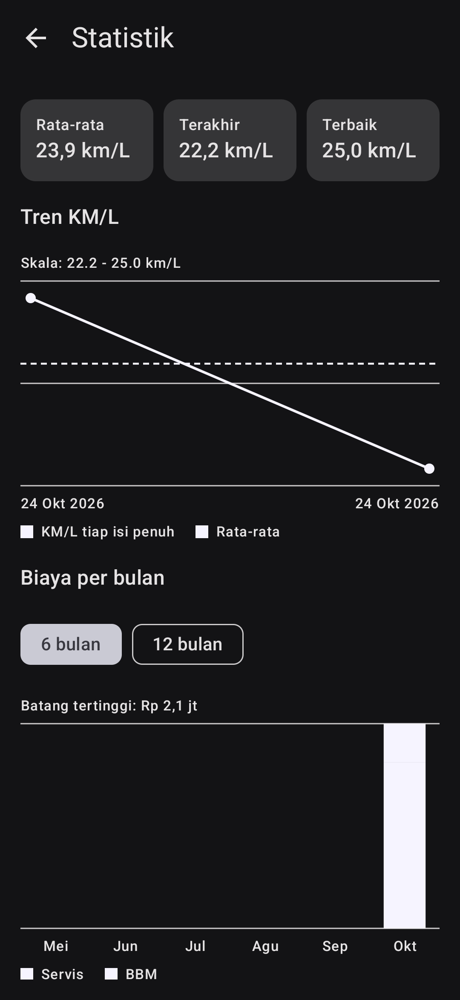

# Garage Journal - Motorcycle Maintenance & Fuel Log

**Garage Journal** is an offline-first Android application built with Kotlin and Jetpack Compose to help motorcycle owners track maintenance history, manage vehicle profiles, and calculate real-time fuel efficiency (KM/Liter).

Built with modern Android development standards, this project demonstrates robust local data persistence, clean architecture, and reactive UI patterns.

## App Screenshots

| 01. Vehicle List | 02. Vehicle Detail | 03. Service Log | 04. Add Service Form | 
| 05. Fuel Log | 06. Statistics |
| :---: | :---: | :---: | :---: |
| :---: | :---: |
|  |  |  |  |  |  |


## Features

* **Multi-Vehicle Management:** Track multiple vehicles with initial and current odometer readings.
* **Maintenance & Service Logging:** Keep detailed records of repairs, oil changes, replaced parts, costs, and attached receipt photos.
* **Fuel Tracker & Calculator:** Automatically calculates consumption efficiency (**KM/Liter**) per refuel entry with partial-fill tracking support.
* **Offline-First Storage:** Reliable local data storage using Room Database.
* **Interactive Dashboard:** Clear overview of overall maintenance expenses and fuel metrics.

## Tech Stack & Architecture

This application strictly adheres to Google's recommended Modern Android Development (MAD) practices:

* **Language:** [Kotlin](https://kotlinlang.org/) (v2.2.10)
* **UI Toolkit:** [Jetpack Compose](https://developer.android.com/jetpack/compose) with Material3
* **Database:** [Room Database](https://developer.android.com/training/data-storage/room) via KSP (Kotlin Symbol Processing)
* **Architecture:** MVVM (Model-View-ViewModel) + Clean Architecture principles
* **Asynchronous & Reactive:** Kotlin Coroutines & `StateFlow` / `SharedFlow`
* **Navigation:** Jetpack Compose Navigation

## Database Schema (ERD)

```
+-----------------------+       1 : N       +-----------------------+
|        VEHICLE        |-------------------|    MAINTENANCE_LOG    |
+-----------------------+                   +-----------------------+
| PK | id               |                   | PK | id               |
|    | name             |                   | FK | vehicle_id       |
|    | license_plate    |                   |    | service_type     |
|    | current_odometer |                   |    | cost             |
+-----------------------+                   |    | date_millis      |
            |                               |    | receipt_image_path|
            | 1 : N                         +-----------------------+
            |                               
            +-------------------------------|       FUEL_LOG        |
                                            +-----------------------+
                                            | PK | id               |
                                            | FK | vehicle_id       |
                                            |    | fuel_liters      |
                                            |    | total_cost       |
                                            |    | odometer         |
                                            +-----------------------+
```

## Getting Started

### Prerequisites

* Android Studio Ladybug (or newer)
* Android SDK version 35
* JDK 11 or higher

### Installation

1. Clone the repository:
   ```bash
   git clone https://github.com/your-username/GarageJournal.git
   ```

2. Open the project in **Android Studio**.

3. Sync Gradle files (`File -> Sync Project with Gradle Files`).

4. Build and run on an emulator or physical device (Android 8.0+ / API level 26+).

## Project Roadmap

* [x] Room Database & Schema Setup
* [x] Multi-Vehicle CRUD Support
* [x] Fuel Log & KM/L Calculator Logic
* [x] Maintenance Log Tracking & Receipt Image Storage
* [x] Export / Restore Data to CSV
* [x] Automated Service Reminders (`WorkManager`)

## Author

**Sopyan Habibi**
* GitHub: [@SopyanHabibi](https://github.com/SopyanHabibi)
